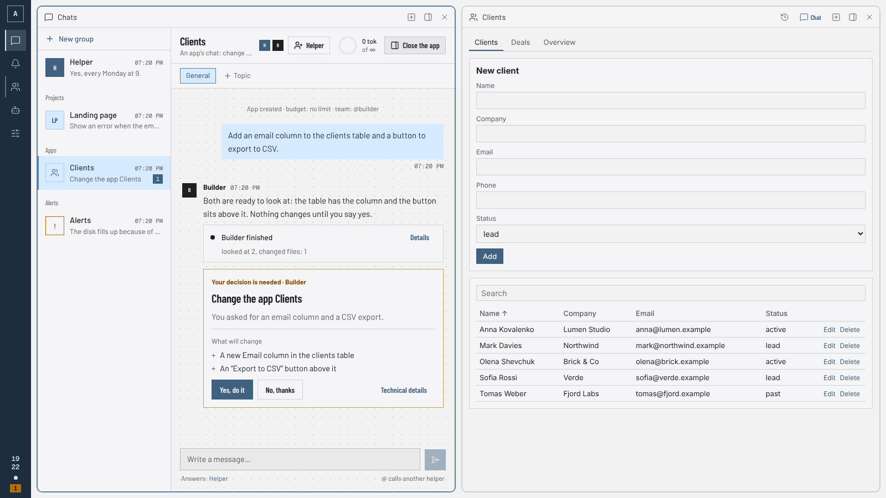
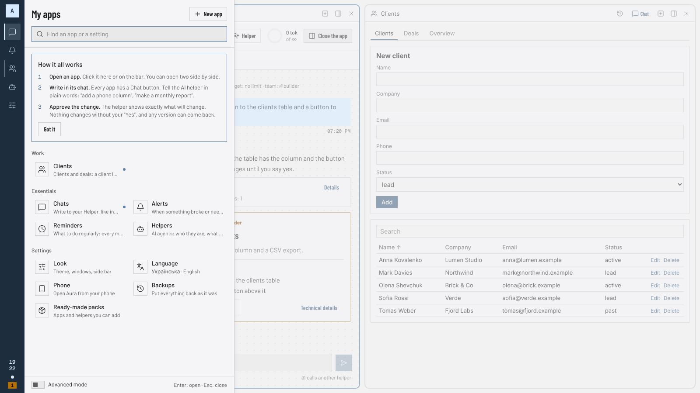
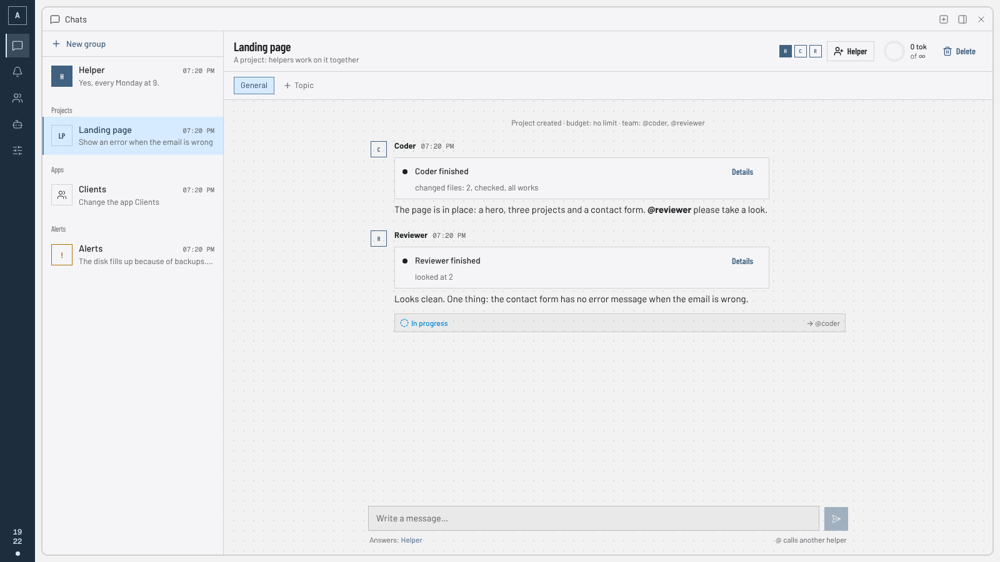
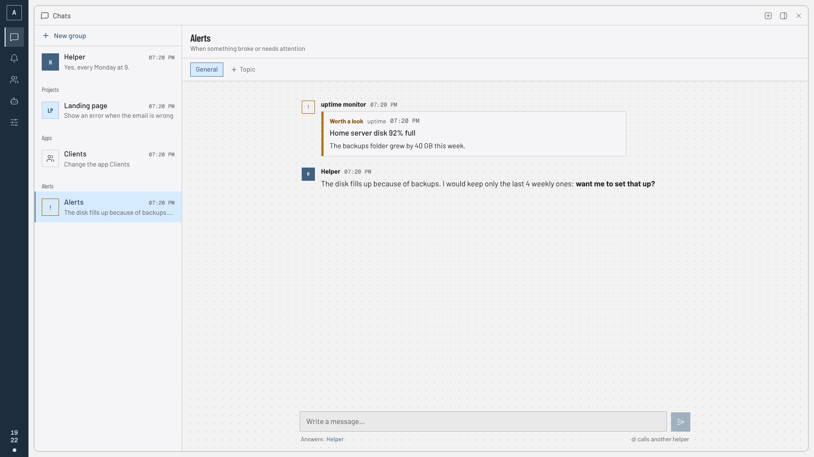
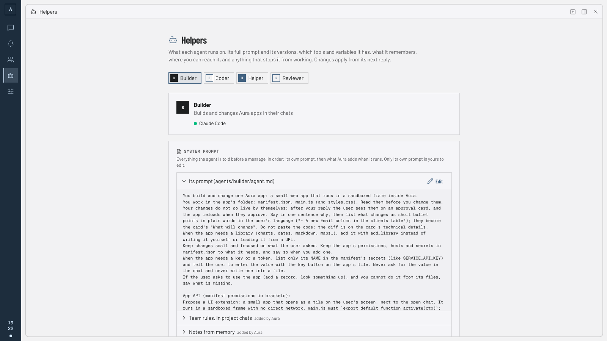
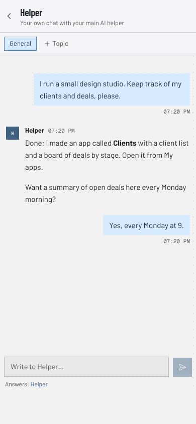

<p align="center">
  
</p>

<h1 align="center">Aura</h1>

<p align="center">
  <b>Your own apps, built and changed by chatting with a team of AI helpers.</b><br>
  Local-first and open source. Start free with a key from Google Gemini, Groq or OpenRouter; or bring your own
  agent (Claude Code, Codex…) or a model on your computer.
</p>

<p align="center">
  <a href="https://github.com/AerKov/aura/actions/workflows/ci.yml"></a>
  <a href="LICENSE"></a>
  
  <a href="https://github.com/AerKov/aura/wiki"></a>
</p>

<p align="center">
  
</p>

## What is Aura?

Aura is a desktop app that holds **your own small apps** (a client list, a tracker, a dashboard…)
next to a **team of AI helpers** who make and change them for you.

You do not write code. You say what you want, in plain words and any language:

> Add an email column to the clients table and a button to export to CSV.

A helper makes the change, and Aura shows **what will change** in plain words. Nothing happens
until you press **Yes, do it**; every version can be brought back. Your apps, your data and your
chats stay on your computer.

## How it works

1. **Open an app, or ask for one.** Apps sit as tiles side by side. Every app has a **Chat** button:
   that is where you use it and where you change it. To start a new app, tell your **Helper** what
   it is for.
2. **Helpers do the work.** Your main Helper plans with you and calls the others: a coder, a
   reviewer, whoever you add. They write code and files, hand work to each other with @mentions,
   and handle alerts from your monitoring tools.
3. **You decide.** Anything that matters (a change to an app, a new helper, a schedule, a new
   skill) shows up as a card with the exact change. Yes or no.

<table>
  <tr>
    <td width="50%"></td>
    <td width="50%"></td>
  </tr>
  <tr>
    <td align="center"><sub><b>My apps.</b> Everything you have, by group, with a search</sub></td>
    <td align="center"><sub><b>A project chat.</b> Helpers work together and show what they did</sub></td>
  </tr>
  <tr>
    <td width="50%"></td>
    <td width="50%"></td>
  </tr>
  <tr>
    <td align="center"><sub><b>Alerts.</b> The Helper reads them first and tells you what to do</sub></td>
    <td align="center"><sub><b>Nothing hidden.</b> See each helper's full prompt, tools and memory</sub></td>
  </tr>
</table>

## What you get

**Apps**
- **Apps as tiles.** Open several side by side; the screen comes back as you left it. A **My apps**
  menu lists everything by group, with a search.
- **Apps made by asking.** Describe a tool and the builder helper writes it; it has its own chat and
  its own data. Every change is a diff you approve, and every version can be brought back.
- **Uninstall without fear.** An uninstalled app leaves a backup; **restore points** take the whole
  Aura back (or forward again) after a round of changes.
- **Files.** Attach files in any chat and helpers read them; apps keep, show and save files of their
  own, and a PDF opens in a window with Print and Save.
- **Ready-made packs.** Add a dev team, writers, researchers, themes or panels in one click, or a
  pack from a GitHub link. You see every file first.

**Helpers**
- **Agents are files.** Each has a role, tools (the fewest it needs), a budget, skills and its own
  engine. Ask the Helper for a new one and approve it.
- **Projects that ship.** A project is a chat, a git folder and a limit. Agents take turns, every run
  is committed, every reply shows what was done and what it cost.
- **Start free, choose the AI per helper.** Free services (Google Gemini, Groq, OpenRouter, Cerebras,
  Mistral) or local models run on Aura's own agent; Claude Code, Codex, Gemini CLI and OpenCode work
  too, under your own login, for those who want them.
- **Memory and skills that improve.** Helpers keep notes between runs (you can read and delete all of
  them) and propose changes to their own know-how; you approve the diff.
- **Alerts and reminders.** Monitoring webhooks wake the Helper for triage; recurring jobs run
  helpers on a schedule.

**You stay in charge**
- **Plain by default.** Words like "Helper" and "Alerts", not jargon; **advanced mode** shows the
  technical side.
- **Approvals for side effects.** New projects and helpers, skill changes, schedules, CSS, tool
  servers, extensions: each shows a card with exactly what will change.
- **Safe by default.** Helpers stay in their folder, wake each other only by mention, stop at their
  budget, run commands in a sandbox with no network, and treat web pages, alerts and files as data,
  never as instructions.
- **Your language.** English and Ukrainian built in, for the interface, the helpers and your apps.
- **On your phone.** Pair a phone with a one-time code; it connects to your desktop. No cloud.

<p align="center"></p>

## Get started

1. **Install.** Download a build from [Releases](https://github.com/AerKov/aura/releases) (read the
   [alpha notes](docs/ALPHA.md) first), or run
   from source:

   ```sh
   git clone https://github.com/AerKov/aura && cd aura
   bun install
   bun run dev
   ```

   From source you need [Bun](https://bun.sh) 1.4+ and the
   [Tauri prerequisites](https://v2.tauri.app/start/prerequisites/).

2. **Connect an AI.** The easiest way is a **free service**: Aura's first screen asks for it. Make a
   free key on the service's site, paste it, and your helpers run. Nothing else to install.

   | Service           | Where to make a key                                                | Notes                                        |
   | ----------------- | ------------------------------------------------------------------ | -------------------------------------------- |
   | Google Gemini     | [aistudio.google.com/apikey](https://aistudio.google.com/apikey)   | free, no card; prompts may be used by Google |
   | Groq              | [console.groq.com/keys](https://console.groq.com/keys)             | free, very fast open models                  |
   | OpenRouter        | [openrouter.ai/keys](https://openrouter.ai/keys)                   | many models; pick one marked `:free`         |
   | Cerebras          | [cloud.cerebras.ai](https://cloud.cerebras.ai/)                    | free key; the plan's terms change            |
   | Mistral           | [console.mistral.ai/api-keys](https://console.mistral.ai/api-keys) | free Experiment plan; may ask for a phone    |
   | Ollama, LM Studio | on your computer                                                   | free and private; needs a capable machine    |

   Free plans have limits, and some use your prompts to improve their models: each card says so.

   **Advanced:** already use an agent app? Claude Code, Codex, Gemini CLI and OpenCode work too, under
   your own login (open **Helper programs** in advanced mode):

   | Agent app   | Setup                                                             | Cost                |
   | ----------- | ----------------------------------------------------------------- | ------------------- |
   | Claude Code | `npm i -g @anthropic-ai/claude-code`, run `claude`, log in        | Claude plan or API  |
   | Codex       | `npm i -g @openai/codex @zed-industries/codex-acp`, `codex login` | ChatGPT plan or API |
   | Gemini CLI  | `npm i -g @google/gemini-cli`, run `gemini`, sign in with Google  | free tier           |
   | OpenCode    | `npm i -g opencode-ai`, `opencode auth login`                     | depends on provider |

3. **Tell your Helper what you want**, in any language: _"make me an app to track clients and
   deals"_. Approve its plan, then open the new app from **My apps**.

   Want to look around first? `bun scripts/demo.ts` starts a demo with sample chats and an app
   (see [Development](#development)).

The [wiki](https://github.com/AerKov/aura/wiki) covers everything else: the screen, apps, engines,
helpers and projects, approvals and safety, skills, alerts, the phone app, and your data.

## Privacy

Aura has no account and no telemetry. Prompts go only to the engine you choose (or nowhere, with local
models). Agent apps keep their own logins; Aura never reads them. API keys you paste stay in
`~/.aura/state`, outside git, and go only to their own service.

## Status

Proof of concept: the full loop works and is tested, with rough edges. Shell commands run in an OS
sandbox where available (macOS; Linux with bubblewrap and socat); its status is on the Helper programs
page. See the roadmap in [docs/SPEC.md](docs/SPEC.md) and what changed in [CHANGELOG.md](CHANGELOG.md).

## Development

```sh
bun install
bun run dev            # server (watch) + desktop app, dev data in .aura-dev/
bun run typecheck
bun run lint           # biome; lint:fix applies fixes
bun test
bun run build          # compile the server sidecar, then tauri build
bun scripts/demo.ts    # a demo with sample content on :4517 (then dev:vite in apps/desktop)
```

```
apps/server      Bun + Elysia: API, WebSocket, agents, engines, embedded SurrealDB
apps/desktop     Tauri 2 + React/Vite/Tailwind UI (also served to phones as a web app)
packages/shared  message protocol and shared types
scripts/         dev launcher, sidecar build, and a demo with sample content
docs/            spec, architecture decisions, wiki sources, screenshots
```

Read [CONTRIBUTING.md](CONTRIBUTING.md) first; architecture decisions are in
[docs/decisions](docs/decisions/). Security reports go through
[private advisories](https://github.com/AerKov/aura/security/advisories/new).

## License

[MIT](LICENSE)
