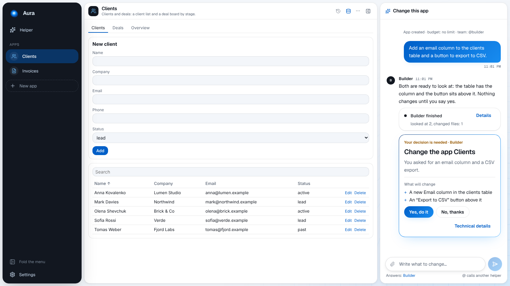
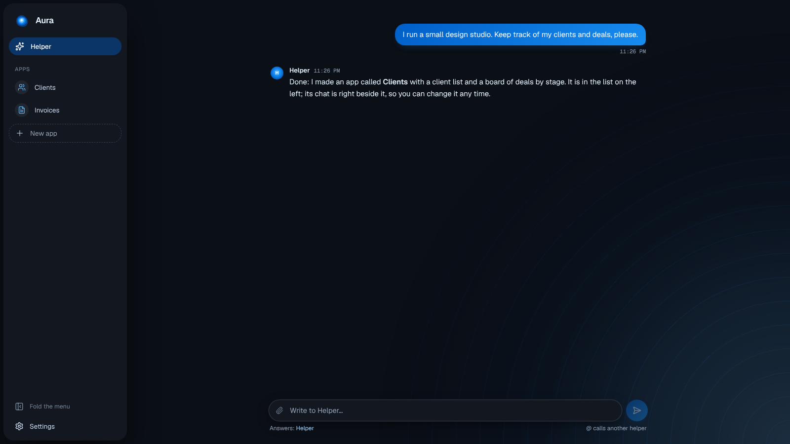
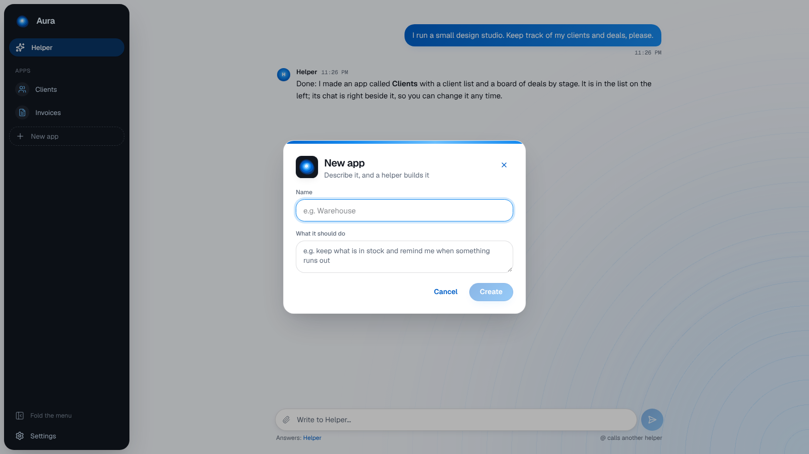
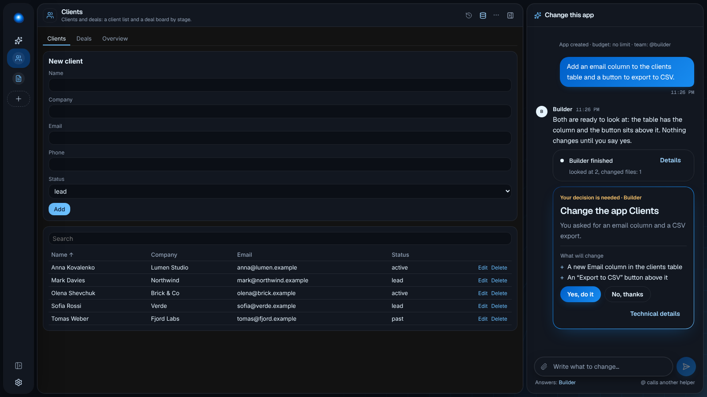
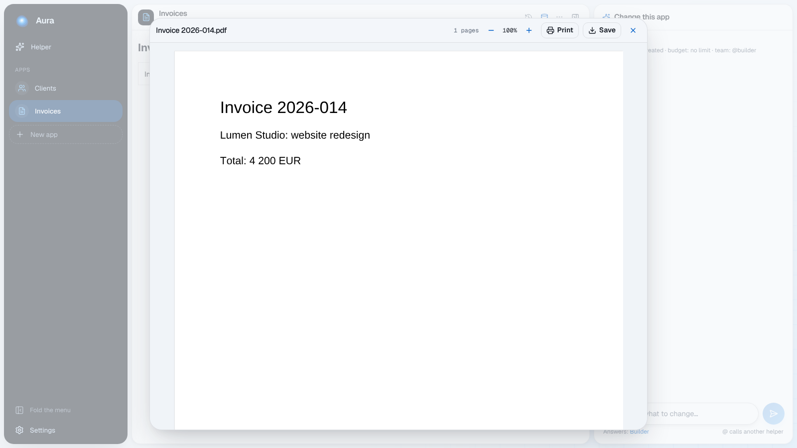
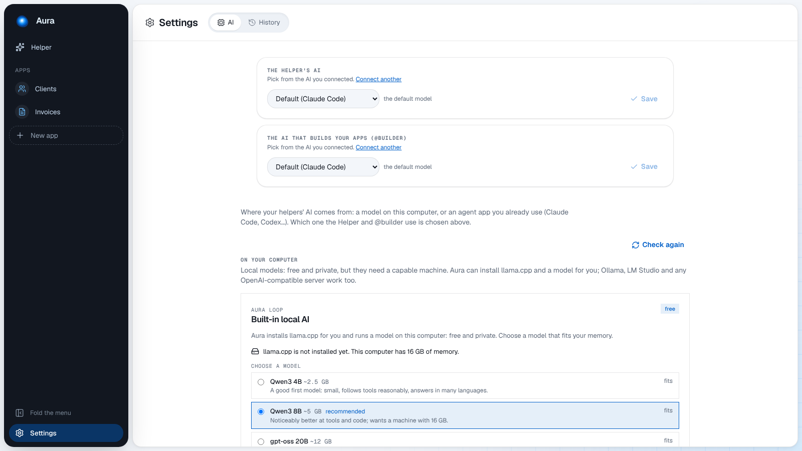
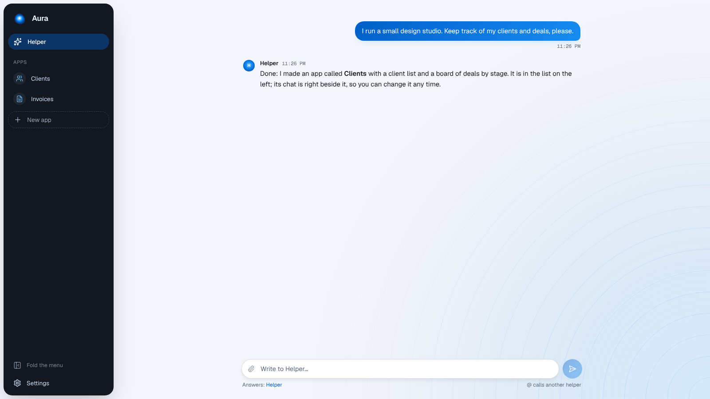

<p align="center">
  
</p>

<h1 align="center">Aura</h1>

<p align="center">
  <b>Build your own apps by chatting. On your computer.</b><br>
  Local-first and open source. Runs a model on your computer (Aura installs it for you), or Claude
  Code or Codex under your own Claude or ChatGPT plan.
</p>

<p align="center">
  <a href="https://github.com/AerKov/aura/actions/workflows/ci.yml"></a>
  <a href="LICENSE"></a>
  
  <a href="https://github.com/AerKov/aura/wiki"></a>
  <a href="https://aerkov.github.io/aura/"></a>
</p>

<p align="center">
  
</p>

## What is Aura?

Aura is a desktop app for **your own small apps**: a client list, a stock tracker, an invoice
book, a habit board. You do not write code. You tell your **Helper** what you need, in plain words
and any language:

> Keep track of my clients and deals, please.

The Helper makes the app. Each app opens with **its own chat beside it**, where **@builder**
changes it whenever you ask:

> Add an email column to the clients table and a button to export to CSV.

Aura shows **what will change**, and you can look at the app after the change before deciding.
Nothing happens until you press **Yes, do it**, and every version can be brought back. Your apps,
your data and your chats stay on your computer.

<table>
  <tr>
    <td width="50%"></td>
    <td width="50%"></td>
  </tr>
  <tr>
    <td align="center"><sub><b>Your Helper.</b> Say what you need</sub></td>
    <td align="center"><sub><b>New app.</b> A name and a sentence are enough</sub></td>
  </tr>
  <tr>
    <td width="50%"></td>
    <td width="50%"></td>
  </tr>
  <tr>
    <td align="center"><sub><b>Dark mode, menu folded.</b> More room for the app</sub></td>
    <td align="center"><sub><b>Files.</b> Apps keep, show, print and save them</sub></td>
  </tr>
  <tr>
    <td width="50%"></td>
    <td width="50%"></td>
  </tr>
  <tr>
    <td align="center"><sub><b>Settings.</b> Pick the AI; everything else is asked</sub></td>
    <td align="center"><sub><b>Light or dark.</b> Following your system</sub></td>
  </tr>
</table>

## What you get

- **Apps made by asking.** Each app is a git folder with its code, its own data (a small database
  or files), its own secrets and its own chat. It runs in a sandboxed frame with only the
  permissions you granted.
- **Every change is yours to approve.** A diff in plain words, a preview of the app after the
  change, and a version you can go back to.
- **Uninstall without fear.** An uninstalled app leaves a backup that Settings → History brings
  back.
- **Files.** Attach files in any chat; apps keep, show, print and save files of their own.
- **A look you can change by asking.** Aura has no look of its own: the default theme is a file of
  yours. "Make it warmer", "rounder corners", "a green sidebar": the Helper proposes the CSS and you
  try it on before saying yes.
- **Your language.** English and Ukrainian built in, for the interface, the Helper and your apps.
- **Safe by default.** Helpers stay in your data folder, run commands in a sandbox with no network,
  stop at their budget, and treat web pages and files as data, never as instructions.

## How is it different?

Plenty of tools build apps from a chat. Most are for developers shipping a web product (Lovable,
Bolt, Replit, v0, and locally Dyad or bolt.diy), or make a small page in a cloud service (Claude
artifacts, Google Opal). Aura is for someone who wants **their own tools, on their own computer,
without ever seeing code**.

|                                    | Aura | Dyad, bolt.diy | Lovable, Bolt, Replit, v0 | Claude artifacts, Opal |
| ---------------------------------- | :--: | :------------: | :-----------------------: | :--------------------: |
| Runs on your computer              |  ✓   |       ✓        |             –             |           –            |
| Local model built in               |  ✓   |   via Ollama   |             –             |           –            |
| No code to look at                 |  ✓   |       –        |          partly           |           ✓            |
| Apps live together, ready to use   |  ✓   |       –        |             –             |         partly         |
| Each app keeps its own data        |  ✓   | Supabase, Neon |        their cloud        |  20 MB / their cloud   |
| A chat beside each app uses it too |  ✓   |       –        |             –             |           –            |
| Publish to the web                 | soon |       ✓        |             ✓             |       ✓ (a link)       |
| Run an app without the builder     | soon |  as a project  |       as a web app        |           –            |

The details, with sources: [docs/COMPETITORS.md](docs/COMPETITORS.md).

## What's coming

Promises for the next versions, in this order:

1. **Share an app as a `.aura` file.** **Export** in an app's menu saves its code and versions
   (never its secrets; its data only if you ask). **Install an app** from a file shows a card with
   what the app wants (permissions, hosts, the names of its secrets) before anything happens; once
   installed it gets its own chat with @builder, like the apps you make.
2. **Your app as a desktop program of its own.** **Make a program** turns an app into a separate
   program with its own name and icon that opens without Aura, on macOS, Windows and Linux. It
   needs nothing installed: Aura packs the app with a small ready-made runner (built with Tauri),
   in seconds. The program keeps the app's data, files and secrets; changing it stays in Aura,
   which makes a new version.
3. **Publish an app to the web.** Put an app online for other people to use, from its menu: a
   static build for apps that keep data in the browser, or a small server for apps that share data.
   You choose where it goes; your own copy keeps living in Aura.

Details and progress: the roadmap in [docs/SPEC.md](docs/SPEC.md#12-roadmap).

## Get started

1. **Install.** Download a build from [Releases](https://github.com/AerKov/aura/releases) (read the
   [alpha notes](docs/ALPHA.md) first), or run from source:

   ```sh
   git clone https://github.com/AerKov/aura && cd aura
   bun install
   bun run dev
   ```

   From source you need [Bun](https://bun.sh) 1.4+ and the
   [Tauri prerequisites](https://v2.tauri.app/start/prerequisites/).

2. **Connect an AI** in Settings → AI. The easiest way is the **built-in local AI**: pick a model
   that fits your computer and approve the download. Aura installs llama.cpp and the model, checks
   their checksums, and runs it only on this computer.

   | Source            | Setup                                                             | Cost                      |
   | ----------------- | ----------------------------------------------------------------- | ------------------------- |
   | Built-in local AI | Settings → AI: Aura installs llama.cpp and a model                | free and private          |
   | Ollama, LM Studio | on your computer, then Settings → AI                              | free and private          |
   | Claude Code       | `npm i -g @anthropic-ai/claude-code`, run `claude`, log in        | Claude plan or API        |
   | Codex (ChatGPT)   | `npm i -g @openai/codex @zed-industries/codex-acp`, `codex login` | ChatGPT plan (Plus, Pro…) |

3. **Tell your Helper what you want**: _"make me an app to track clients and deals"_. Approve it,
   and the app opens with @builder at work beside it.

   Want to look around first? `bun scripts/demo.ts` starts a demo with sample apps (see
   [Development](#development)).

The [wiki](https://github.com/AerKov/aura/wiki) covers the rest: apps, the AI, approvals and
safety, the look, and your data.

## Privacy

Aura has no account and no telemetry. Prompts go only to the AI you choose (or nowhere, with a local
model). Claude Code and Codex keep their own logins; Aura never reads them. App secrets stay in `~/.aura/state`,
outside git, and go only to the hosts the app was allowed to reach.

## Status

Alpha: the whole loop works and is tested, with rough edges. Shell commands run in an OS sandbox
where available (macOS; Linux with bubblewrap and socat). See [docs/SPEC.md](docs/SPEC.md) and
[CHANGELOG.md](CHANGELOG.md).

## Development

```sh
bun install
bun run dev            # server (watch) + desktop app, dev data in .aura-dev/
bun run typecheck
bun run lint           # biome; lint:fix applies fixes
bun test
bun run build          # compile the server sidecar, then tauri build
bun scripts/demo.ts    # a demo with sample content on :4517 (then dev:vite in apps/desktop)
```

```
apps/server      Bun + Elysia: API, WebSocket, the Helper and @builder, embedded SurrealDB
apps/desktop     Tauri 2 + React/Vite/Tailwind UI
apps/site        the landing page (GitHub Pages), in English and Ukrainian
packages/shared  message protocol, shared types and the default theme
scripts/         dev launcher, sidecar build, demo and screenshots
docs/            spec, architecture decisions, wiki sources, screenshots
```

Read [CONTRIBUTING.md](CONTRIBUTING.md) first; architecture decisions are in
[docs/decisions](docs/decisions/). Security reports go through
[private advisories](https://github.com/AerKov/aura/security/advisories/new).

## License

[MIT](LICENSE)
