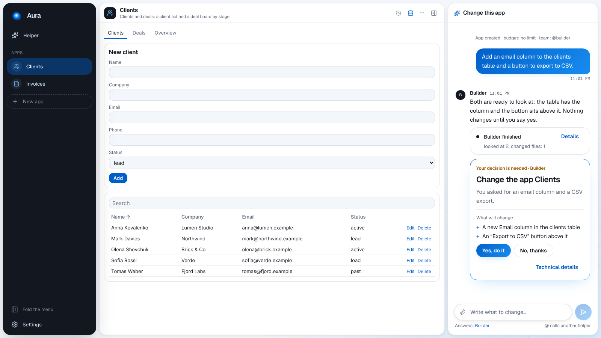

# Aura

**Build your own apps by chatting, on your computer.**

> **Status:** alpha (version 0.43). It works end to end, but expect rough edges.

Tell your **Helper** what you need: _"keep track of my clients and deals"_. The Helper makes an app;
it opens with **its own chat beside it**, where **@builder** changes it whenever you ask. Every
change is shown to you first, and every version can be brought back. Your apps, your data and your
chats stay on your computer.

- [Getting started](Getting-Started): install, connect an AI, make your first app.
- [The screen](The-Screen): the sidebar, the Helper, an app with its chat, Settings.
- [Apps](Apps): making, changing, versions, data, files, secrets, uninstalling.
- [The AI](Engines): the built-in local AI, Ollama, LM Studio, Claude Code.
- [Approvals and safety](Approvals-and-Safety): what asks you first, and what the helpers may do.
- [The look and the language](Customization): change anything by asking.
- [Your data](Your-Data): where everything is.
- [Troubleshooting](Troubleshooting).
