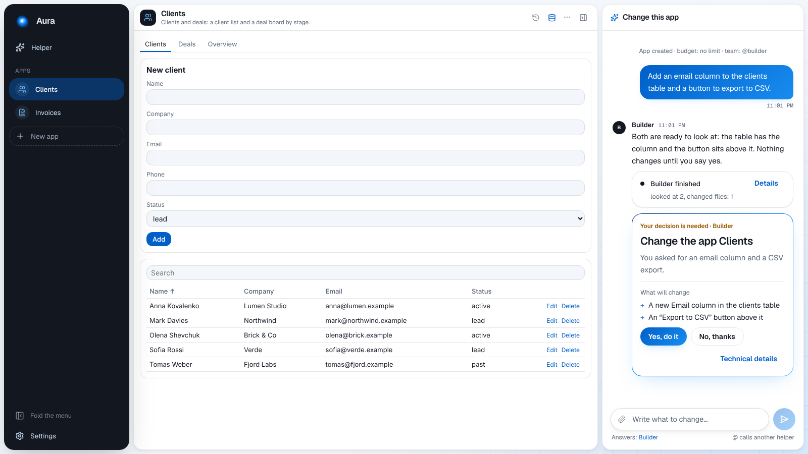
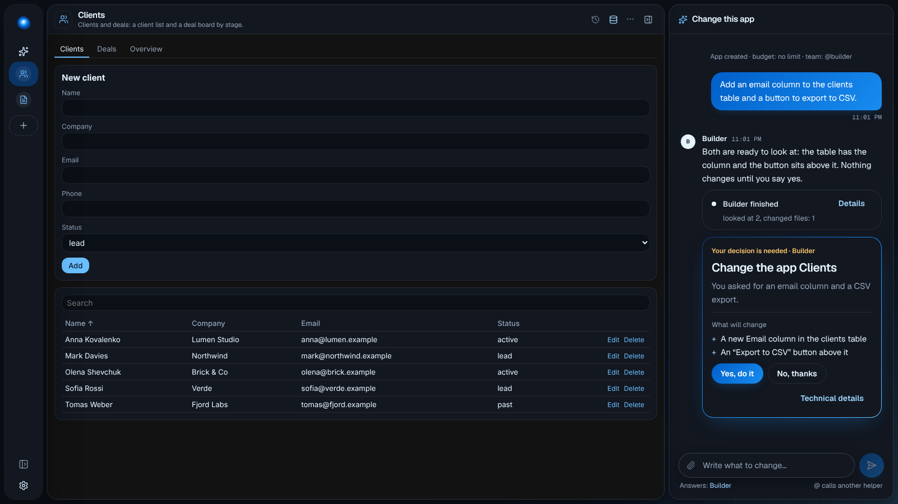

# The screen

Aura has one screen: a **sidebar** on the left and **one thing** beside it.

## The sidebar

- **Helper**: your chat with the Helper. A dot pulses while a helper is working.
- **Apps**: your apps, by name. A coloured dot means a change waits for your decision. With many
  apps a search appears.
- **New app**: a name and what it should do; the app opens with @builder at work.
- **Settings**: **AI** (where the AI comes from and which one the Helper and @builder use) and
  **History** (uninstalled apps to bring back).

**Fold the menu** at the bottom folds the sidebar to icons (it also folds by itself on a narrow
window). Aura opens where you left it.

## An app

The app runs on a card. Its header has its name and description, and on the right:

- **Now / After the change** when a change waits for you: look at the app before deciding; the bin
  discards the change.
- **History of changes** (the clock): every version; **Bring back** restores one.
- **Its data** (the database): where it keeps data, export, delete.
- **Its secrets** (the key), if it talks to a service.
- **⋯**: uninstall (a backup is kept in Settings → History).
- **Hide the chat / Show the chat**.

**Its chat** is beside it: tell @builder what to change, or ask it to use the app for you
(_"add Petrenko, a lead from the fair"_). A plain message goes to @builder; mention another helper
with `@` if you added one.

## The Helper's chat

Where you say what to build, ask how Aura works, or ask to change the look or the language.
Replies to a message work like in Telegram. Attach files with the paperclip or by dropping them.
